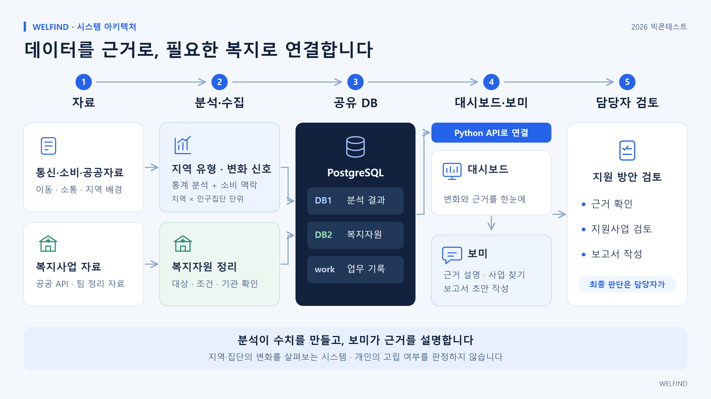

# 사회적 고립 위험신호 탐지 AI Agent

> **실행:** `frontend`에서 의존성 설치·빌드 후 `python main.py`로 실행합니다. [실행 방법](#13-실행-방법)을 먼저 확인하세요.

> **2026 빅콘테스트 · AI데이터 활용 분야**
>
> 통신·소비·공공데이터를 활용하여 지역 및 인구집단 단위의 사회적 고립 위험신호를 탐지하고, AI Agent를 통해 적절한 복지자원과 지원 방안을 연결하는 시스템

---

## 문서 안내

- [화면 개발·지도 출처](frontend/README.md)
- [서버·보미·에이전트](backend/README.md)
- [데이터 전처리·분석·수집](pipelines/README.md)
- [DB1 실행·분석 기준](pipelines/db1/README.md)
- [팀 문서·아키텍처 안내](docs/README.md)

## 1. 프로젝트 개요

본 프로젝트는 개인의 사회적 고립 여부를 직접 판단하는 것이 아니라, **지역 × 인구집단 단위에서 관찰되는 행동 및 사회적 맥락의 변화로부터 사회적 고립과 관련될 수 있는 위험신호를 탐지**하는 것을 목표로 합니다.

탐지된 위험신호에 대해 AI Agent가 지역의 상황과 지원 필요성을 분석하고, DB2에 구축된 복지자원 정보를 바탕으로 적절한 지원기관·프로그램·서비스를 연결합니다.

### 핵심 원칙

- 개인 단위의 사회적 고립 여부를 판정하지 않습니다.
- 단일 행동지표만으로 고립을 판단하지 않습니다.
- 행동 변화와 사회적 맥락을 함께 고려합니다.
- 데이터가 보여주는 사실과 AI Agent의 해석을 구분합니다.
- 위험신호와 추천 결과에 대해 데이터 기반의 근거를 제시합니다.

---

## 2. 시스템 아키텍처



> 발표용 16:9 그림입니다. [고해상도 PNG](docs/architecture/system_architecture.png) · [편집 가능한 SVG](docs/architecture/system_architecture.svg) · [그림 안내](docs/README.md#architecture)

- 웹 서비스의 업무 기록은 모두 공유 PostgreSQL `work` 스키마에 저장합니다. SQLite는 DB1 분석 실행기의 작업·전달 파일(`pipelines/db1/outputs/db1.sqlite`)과 테스트용 메모리 DB에만 씁니다.
- 위험신호 수치는 Python 통계 분석으로 만들고, LLM은 수치를 계산하지 않고 근거를 설명합니다.

---

## 3. 데이터 구성

### DB1 · 분석 데이터

지역 유형의 배경 지표는 **65세 이상 등록인구 중 독거노인 비율**을 사용합니다.
2025년 연간 독거노인 수를 2025년 4분기 65세 이상 등록인구로 나눈 값입니다.
월별 고립률이나 개인의 고립 여부를 뜻하지 않으며, 공개 시점이 확인되지 않은 사후 배경자료입니다.
모델과 실행 기준은 [DB1 서비스 통합](docs/db1-integration.md)을 참조하세요.

DB1은 프로젝트의 **데이터 분석 및 위험신호 탐지 영역**입니다.

#### 빅콘테스트 제공 데이터

| 데이터        | 주요 활용                                 |
|---------------|-------------------------------------------|
| 통신 유동인구 | 지역·연령·성별·시간·요일별 이동 패턴 분석 |
| 카드 소비     | 지역·연령·성별·시간·업종별 소비 패턴 분석 |

빅콘테스트 제공 데이터는 모델 개발과 위험신호 검증에 핵심적으로 활용합니다.

#### 공공데이터

공공데이터는 행동 데이터만으로 설명하기 어려운 지역 및 인구집단의 맥락을 보완하기 위해 활용합니다.

현재 우선 검토하는 데이터:

- 서울시 사회적 신뢰
- 함께 여가활동하는 사람
- 서울시 1인가구(연령별)

이 데이터들은 사회적 고립을 직접 나타내는 정답(label)이 아니라 **행동 변화의 맥락을 해석하기 위한 보조 지표**로 활용합니다.

### DB2 · 복지 / 자원 데이터

DB2는 위험신호를 확인한 뒤 담당자와 챗봇이 실제 지원자원을 찾을 수 있도록 구성합니다.

| 자료 | 위치 | 사용처 |
|---|---|---|
| 지자체 복지사업(공공 API 정기 수집) | PostgreSQL `db2.local_welfare_services` 등 | 사업 매칭 검토 |
| 팀 정리 복지사업·강남구 정책 자료 | `backend/chatbot/welfare/data/*.json` | 보미 복지사업 안내 |

사업명·대상·이용 조건·담당 기관을 담고 있으며, 담당자가 조건을 검토해 기관 협의·프로그램 추진으로 연결합니다.

---

## 4. DB1 분석 프로세스

### ① 데이터 구조 및 컬럼 확인
시간·공간·연령·성별 단위, 결측치·이상치, 데이터 기간 등을 확인하고 공통 분석 기준을 정의합니다.

### ② 분석 단위 통합

기본 분석 단위:

```text
지역 × 연령집단 × 시간
```

필요한 경우:

```text
지역 × 연령집단 × 성별 × 시간
```

### ③ 행동 Feature 생성

통신 및 카드 데이터에서 지역·인구집단의 행동 패턴을 나타내는 Feature를 생성합니다.

- 유동인구 변화
- 시간대별 이동 패턴
- 요일별 이동 패턴
- 소비 규모 변화
- 소비 활동 패턴 변화
- 업종별 소비 변화

### ④ 변화(Change) 분석

특정 시점의 절대적인 수준뿐 아니라 과거 기준선과 비교한 변화를 분석합니다.

```text
현재 수준 → 기준 기간 비교 → 변화량 / 변화율
```

### ⑤ 지속성(Persistence) 분석

일시적인 변화와 지속적인 변화를 구분합니다.

```text
단기 변화 → 지속 여부 확인 → 반복적인 변화인지 확인
```

### ⑥ 다차원성(Multidimensionality) 분석

하나의 지표만으로 위험신호를 판단하지 않고 여러 행동 영역에서 변화가 동시에 나타나는지 확인합니다.

```text
이동 변화 + 소비 변화 + 사회적 맥락
                    ↓
             종합적인 위험신호 검토
```

---

## 5. 분석 방법 (통계 탐지 + ML 군집)

LLM에게 수치 계산이나 위험점수 산출을 맡기지 않고, Python 통계·ML 분석으로 결과를 만듭니다. 딥러닝(DL) 모델과 지도학습 예측 모델은 사용하지 않습니다. 고립 여부를 나타내는 정답(label)이 없기 때문입니다.

| 단계 | 방법 | 결과 |
|---|---|---|
| Analysis1 지역 유형 | scikit-learn `StandardScaler` → `PCA` → `KMeans` 군집. 실루엣 점수·ARI로 군집 수와 안정성 확인. 고정 모델 `analysis1_2025H2_elder_v2`(joblib) | 동별 지역 유형·배경 지표 (`db1.analysis1_region_typology`) |
| Analysis2 변화 탐지 | 동별 월 변화에서 강남구 공통 변화를 뺀 잔차를 과거 중앙값·MAD로 표준화(robust z). 보정한 임계값 이하이고 감소 방향일 때 신호 | 신규·연속·변화 후보 판정 (`db1.analysis2_detections`) |
| Analysis3 소비 맥락 | 상권·카드 소비영역별 과거 동일 분기·전월 대비 기술 통계 | 이동·통신 변화의 보조 맥락 |

자세한 기준은 [DB1 서비스 통합](docs/db1-integration.md)과 `pipelines/db1/Analysis1`, `pipelines/db1/Analysis2`, `pipelines/db1/Analysis3`의 문서를 참고하세요.

---

## 6. AI Agent (보미 챗봇)

보미는 모든 메뉴에서 같은 채팅 하나로 질문을 받습니다. 총괄 에이전트([backend/agents/supervisor.py](backend/agents/supervisor.py))가 질문마다 담당 에이전트를 고릅니다. 별도 에이전트 프레임워크(LangGraph 등) 없이 Python으로 구현했습니다.

```text
사용자 질문 + 화면 맥락(지역·기준월·그룹)
    ↓
가드레일: 개인정보 마스킹, 업무 무관 질문 차단
    ↓
총괄 에이전트: 담당 선택 (외부 AI 사용 시 AI, 아니면 키워드 규칙)
    ↓
지역 변화 신호(v16) │ 지역 분석 │ 복지사업 │ 보고서 작성 │ 안내
    ↓
DB1 근거·DB2/팀 자료를 출처와 함께 답변
```

| 담당 에이전트 | 하는 일 |
|---|---|
| 지역 변화 신호(v16) | 동 단위 이상신호 지역·탐지 기준·연령별 활동·지역 배경·소비 변화를 DB 근거로 답합니다. |
| 지역 분석 | 열어 둔 연령/성별 그룹의 근거와 화면 판정 용어(판단 보류·기준 미해당 등)를 설명합니다. v16 자료가 없는 서버에서는 동 분석도 맡습니다. |
| 복지사업 | 팀 정리 복지사업 자료에서 관련 사업과 담당 기관을 찾습니다. |
| 보고서 작성 | 대화·업무 기록으로 «담당자 검토 전» 보고서 초안을 만듭니다. |
| 보미 안내 | 검토 의견 작성·현장 확인·보고서 작성 주의점 같은 업무 방법과, 업무와 무관한 질문을 안내합니다. |

외부 AI(OpenAI·Anthropic Claude·Google Gemini)는 기본 꺼짐입니다. 끄면 데이터 근거 안내와 자료 검색 결과로만 답합니다. 자세한 내용은 [챗봇 안내](backend/README.md#bomi)를 참고하세요.

---

## 7. 위험신호 해석 구조

본 프로젝트는 단순히 `위험 / 비위험`을 출력하기보다 **판단 근거를 함께 제공하는 구조**를 지향합니다.

```text
Risk Signal
    │
    ├─ 지역
    ├─ 인구집단
    ├─ 관찰 기간
    ├─ 변화한 행동지표
    ├─ 변화의 크기
    ├─ 지속 여부
    └─ 함께 변화한 다른 지표
           │
           ▼
      Context Analysis
           │
           ▼
    Support Need Profile
           │
           ▼
    Resource Search
           │
           ▼
 Intervention Recommendation
```

AI Agent의 결과가 단순한 LLM 생성 문장이 아니라 **DB1의 분석 결과와 DB2의 자원정보를 근거로 생성**되도록 설계합니다.

---

## 8. 웹 대시보드

웹 대시보드는 분석 결과와 AI Agent의 결과를 확인할 수 있는 인터페이스입니다.

### 주요 기능

- 지역별 위험신호 확인
- 연령집단별 위험신호 확인
- 행동지표 변화 시각화
- 위험신호의 근거 확인
- 지역 및 인구집단별 상황 비교
- AI Agent 분석 결과 확인
- 추천 복지자원 확인
- 지원기관 및 프로그램 정보 확인
- 지속적인 모니터링

### 예방·대응 업무와 DB 설계 (2026-09-22)

대응 화면은 개인 대상자 관리 대신 **지역·인구집단별 예방·지원 과제**와 **서비스 연계 현황**을 관리합니다. Agent가 위험신호의 근거를 정리하고 복지자원 후보를 추천하면 담당자가 검토하여 기관 협의, 프로그램 추진, 후속 관찰로 연결합니다. 실제 개인 명단이나 개인별 고립 판정은 제공 집계데이터에서 생성하지 않습니다.

카드 소비의 가맹점 지역은 시군구이므로 유동인구와의 결합 분석은 우선 시군구·월·호환 인구집단 단위로 설계합니다. 카드 주제1의 시간대와 주제2의 고객 거주 시도는 서로 다른 레이아웃이며 실제 제공 파일을 확인하여 선택합니다. 원천 테이블명은 추적을 위해 보존하되 정제·분석·운영 테이블은 별도로 구성합니다.

- [React 실행 및 구성 안내](#최초-설치): 지역·집단별 변화 확인과 서비스 연계 흐름 시연

현재는 React + Vite 화면입니다. DB1 결과 검사·반영과 DB2 사업 후보 조회, 업무 기록과 Word 보고서 저장을 지원합니다. 실제 기관 연락 및 자동 지원 승인은 구현하지 않았습니다. 시연 점수와 Analysis2 결과를 데이터 모드로 구분합니다.

---

## 9. 데이터 갱신 구조

빅콘테스트 제공 데이터와 지속적으로 수집할 수 있는 공공데이터를 구분합니다.

### Competition Dataset

```text
빅콘테스트 제공
통신 + 카드 데이터
        ↓
프로젝트 분석 / 모델 검증
```

### Public Data

```text
공공기관 API
      ↓
정기적 수집
      ↓
데이터 검증
      ↓
DB1 / DB2 업데이트
```

운영 구조에서는 실시간 개인 감시가 아니라 **지역 및 인구집단 단위의 정기적인 변화 모니터링**을 중심으로 합니다.

---

## 10. 기술 스택

| 영역 | 사용 기술 |
|---|---|
| 데이터·분석 | Python, Pandas, NumPy, 공공데이터 API |
| ML | scikit-learn (StandardScaler · PCA · KMeans), joblib |
| 데이터베이스 | PostgreSQL (오라클 클라우드 VM, 스키마 `db1`·`db2`·`work`), SQLAlchemy, psycopg2. DB1 실행기 작업 파일은 SQLite |
| 서버 | Python 표준 `http.server` 기반 HTTP API (`backend/api/server.py`) |
| 화면 | React + Vite |
| AI Agent | 총괄 에이전트(Python, 규칙/AI 라우팅), OpenAI·Anthropic·Gemini SDK (선택, 기본 꺼짐) |
| 보고서 | python-docx (Word) |
| 개발 | Git / GitHub, Python 가상환경, Node.js |

---

## 11. 프로젝트 개발 순서

```text
01. 원천 데이터 구조 확인
        ↓
02. DB1 컬럼 / 분석 단위 정의
        ↓
03. 데이터 전처리
        ↓
04. 행동 Feature 생성
        ↓
05. Baseline 설정
        ↓
06. Change / Persistence 분석
        ↓
07. Multidimensional Feature 구성
        ↓
08. EDA
        ↓
09. 지역 유형 군집(KMeans) / 통계 변화 탐지
        ↓
10. 위험신호 및 분석 결과 DB 저장
        ↓
11. DB2 복지자원 구축
        ↓
12. AI Agent 구현
        ↓
13. 총괄 에이전트 담당 선택 구성
        ↓
14. Web Dashboard 연동
        ↓
15. 정기 데이터 갱신 / 모니터링
```

> **핵심 개발 원칙: Agent부터 만들지 않는다.**
> 먼저 데이터 → Feature → 분석 → 위험신호의 근거를 확립한 후 AI Agent를 연결합니다.

---

## 12. 프로젝트 기대효과

지역과 인구집단에서 나타나는 행동 변화와 사회적 맥락을 데이터로 파악하고, 필요한 지원으로 연결하는 데이터 기반 지원체계를 목표로 합니다.

- 지역별 위험신호의 조기 탐지
- 인구집단별 변화 패턴 파악
- 데이터 기반 상황 분석
- 복지자원 탐색 자동화
- 지원 필요성과 지역 자원의 연결
- 지속적인 지역 단위 모니터링

---

## 13. 실행 방법

### 준비물

- Python 3 가상환경(`.venv`), Node.js 22.12 이상(npm 포함)
- PostgreSQL 접속 정보: 루트에 `.env`를 만들고 `.env.example`을 참고해 `DB_HOST`, `DB_USER`, `DB_PASSWORD` 등을 넣습니다. `.env`는 Git에 올리지 않습니다.
- (선택) `OPENAI_API_KEY` / `ANTHROPIC_API_KEY` / `GEMINI_API_KEY`: 보미의 AI 해석·AI 대화에 사용합니다. 외부 AI는 기본 꺼짐이며 관리자 «AI 설정»에서 켜고 제공사를 고릅니다. 끄면 데이터 근거 안내와 자료 검색으로만 답합니다.

### 처음 한 번 설치

```powershell
.venv/Scripts/python.exe -m pip install -r requirements.txt
cd frontend
npm ci
npm run build
cd ..
```

`npm ci`는 `package-lock.json`에 고정된 버전 그대로 설치합니다. 패키지를 추가·변경할 때만 `npm install <패키지>`를 쓰고, 바뀐 `package-lock.json`을 함께 커밋합니다.

### 실행

```powershell
.venv/Scripts/python.exe main.py
```

브라우저에서 http://127.0.0.1:8503 을 열고 `gangnam01 / demo1234`(강남구 담당자) 또는 `admin / admin1234`(관리자)로 로그인합니다. 시연용 계정이며 실제 인증이 아닙니다. 처음 로그인하면 단계별 사용 안내가 열리고, 오른쪽 위 `?` 버튼으로 다시 볼 수 있습니다.

화면 코드를 고칠 때는 터미널을 하나 더 열어 `frontend`에서 `npm run dev`를 실행하고 http://127.0.0.1:5173 에서 확인합니다. 8503 주소는 마지막 빌드 결과를 보여 주므로, 수정 후 `npm run build`를 다시 해야 반영됩니다.

### 화면이 읽는 자료

| 화면 | 자료 | 위치 |
|---|---|---|
| 지역 현황·지역 분석·보미 분석 설명 | 동별 통화·문자·이동 분석 결과 | DB `db1.analysis2_detections` (없으면 `pipelines/db1/Analysis2/outputs/detection.csv`) |
| 종합 현황 관찰 그룹 | 연령·성별 유동인구 집계 | DB `db1.group_flow_snapshots` (`python -m db.group_repository --build --publish`로 생성) |
| 사업 매칭 검토 | 지자체 복지사업 목록 | DB `db2` (`python -m pipelines.welfare.collect`로 수집) |
| 보미 복지사업 안내 | 팀 정리 복지사업 자료 | `backend/chatbot/welfare/data/*.json` |
| 업무 기록·보고서·협업 기록·집단 검토 메모 | 담당자 업무 기록 | DB `work` 스키마 (처음 사용할 때 자동 생성. 예전 PC별 SQLite 기록은 `python scripts/migrate_work_store.py --apply`로 옮김) |

`.env`의 `WELFIND_DATA_SOURCE`로 분석 결과를 어디서 읽을지 정합니다: `auto`(DB 우선, 실패 시 CSV), `db`, `csv`. 팀 공용 DB 구축은 [오라클 클라우드 DB 구축](docs/오라클_클라우드_DB_구축.md)을 참고하세요.

## 14. 화면 구성

| 메뉴 | 하는 일 |
|---|---|
| 종합 현황 | 이번 달 후보 동의 연령·성별 그룹 브리핑. 왼쪽 «조사 파일» 탭에서 그룹을 고르고, 오른쪽 보미에게 질문합니다. |
| 지역 현황 | 22개 동의 판정 표와 지도. 동을 고르면 왼쪽에 근거가 열립니다. |
| 지역 분석 | «상세 근거»(지표별 표·추이)와 «기간·지역 비교»(최대 4개 동) 탭. ① 분석 확인 저장 → ② 근거 검토 완료로 업무를 시작합니다. |
| 사업 매칭 검토 | 확인한 필요에 맞는 지자체 복지사업을 찾아 검토 기록을 남깁니다. |
| 업무 기록 | 저장한 지역 업무 목록과 검토·후속 조치 기록 |
| 보고서 작성 | 분석과 사업 검토 결과로 Word 보고서 초안을 만들고 저장합니다. |
| 보미에게 질문 | 모든 메뉴에서 같은 챗봇 하나. 총괄 에이전트가 질문마다 담당(분석 근거 설명·복지사업 찾기·보고서 초안)을 골라 답합니다. [챗봇 안내](backend/README.md#bomi) |
| 데이터 관리·활동 이력 | 관리자 전용. 분석 자료 검사·반영과 반영 이력 |

판정(신규·연속·변화 후보 등)은 동 단위 지표가 평소 흐름과 다른지 본 결과이며, 개인의 고립 여부를 판정하지 않습니다.

## 15. 폴더 구조

폴더별 역할과 이전 위치는 [폴더 구성 안내](docs/folder-organization.md)를 참고하세요.

```text
main.py                     공통 실행 시작점
frontend/                   React 화면·화면 테스트
backend/
  api/                      Python HTTP API
  chatbot/                  보미 대화·가드레일·AI 연결
    welfare/app/dialogue/   복지사업 검색·대화 처리
  agents/                   총괄·보고서 작성·사업 매칭
    regional_v16/           v16 지역 변화 신호 에이전트(근거 DB는 git 제외)
  db/                       공유 DB 연결·조회·업무 기록 저장
  services/                 계정·Word 보고서 생성
  resources/                지도 자료·보고서 서식
pipelines/
  db1/                      Analysis1·2·3·맥락 분석·검증·모델
  preprocessing/            원자료 전처리·재현 코드
  regional_analysis/        --analysis 실행점·--preprocess가 쓰는 예전 Analysis2 실행기
  risk_analysis/            별도 위험변화 분석
  welfare/                  DB2 복지사업 수집
data/                       공통 원자료·가공 자료
assets/brand/               로고·캐릭터·브랜드 원본
docs/                       팀 문서·아키텍처·외부 참고자료
scripts/                    실행·이관·정기 수집 도구
deploy/                     배포 설정
runtime/                    로컬 실행 로그
```

### 분석 자료 다시 만들기

프로젝트 루트에서 실행합니다. 원본 ZIP/XLSX는 Git에 없으므로 따로 받아 두어야 합니다.

```powershell
python main.py --preprocess --no-download               # 월별 행동 자료 전처리
python main.py --preprocess-analysis1 --raw-dir "pipelines/preprocessing/regional_types/raw_data"  # 지역 유형(Analysis1) 전처리
python main.py --analysis --no-download                 # Analysis2 변화 탐지
python main.py --risk --input "월별행동.csv"             # 위험 분석
python -m pipelines.welfare.collect --help                      # 복지사업(DB2) 수집
```

DB2 정기 수집은 [DB2 지자체복지 정기 수집](docs/DB2_지자체복지_정기수집.md)을 참고하세요.

## 16. 검증

```powershell
cd frontend
node --test tests/*.test.mjs
npm run build
cd ..
.venv/Scripts/python.exe -m unittest discover -s backend/api/tests
.venv/Scripts/python.exe -m unittest discover -s backend/chatbot/tests -t .
```

서버 테스트는 실제 분석 결과를 읽고, 공유 PostgreSQL 대신 메모리 SQLite에 `work` 스키마를 붙여 로그인·지역 접근·보미 답변·업무 순서·Word 보고서 저장을 검사합니다. 실제 DB 쓰기와 외부 AI 호출은 하지 않습니다. 화면을 브라우저로 직접 조작하는 검사는 `node tests/draft-browser.mjs`이며 Playwright와 Chrome이 필요합니다.

## 17. Team

**SeSAC 08 최종프로젝트**

사회적 고립 예방 및 대응을 위한 AI Agent 개발
