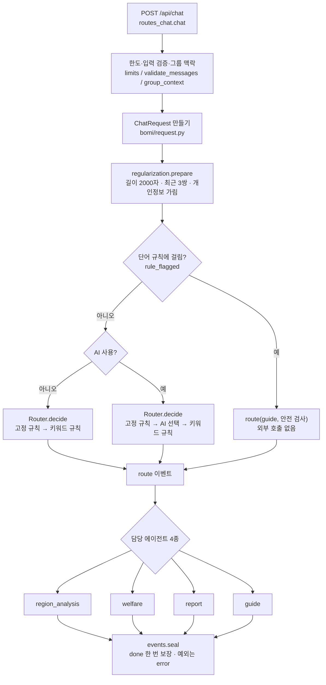

# 보미 채팅 흐름 (backend)

진입점은 `POST /api/chat`(`api/routes_chat.py`)이고, 답변은 `bomi/pipeline.py`가 이벤트 스트림으로 만듭니다.
프론트엔드(`frontend/src/BomiChat.jsx`)와의 이벤트 계약은 기존 backend와 같습니다(`bomi/events.py`).

## 1. 한눈에 보기


> 위 그림은 [chat_flow.mmd](chat_flow.mmd)로 만들었습니다(mermaid). 아래 도식은 같은 흐름의 요약입니다.



## 2. 모듈 책임

| 파일 | 책임 | 하지 않는 일 |
|---|---|---|
| `api/routes_chat.py` | HTTP 요청 검사 → `ChatRequest` | 담당 선택, 답변 생성 |
| `bomi/request.py` | 요청 타입, 메시지·출처 검증 | |
| `bomi/regularization.py` | 규칙·moderate API를 에이전트별 정책으로 적용(입력·출력 규제) | 담당 선택 |
| `bomi/routing.py` | **담당 선택의 유일한 위치** | 자료 유무에 따른 대체 |
| `bomi/questions.py` | 질문 분류 순수 함수·키워드 | |
| `bomi/phrases.py` | 고정 문구·AI 담당 선택 지시문 | 로직 |
| `bomi/agents/*` | 담당별 답변 이벤트 생성 | route·done·개인정보 notice |
| `bomi/events.py` | 이벤트 9종 계약, `seal` | |
| `bomi/pipeline.py` | 위 단계를 순서대로 연결 | |
| `bomi/aio.py` | 동기↔비동기 변환의 유일한 접점 | |
| `bomi/adapters/v16.py` | v16 엔진 연결(sys.path 조정 포함) | |

## 3. 담당 에이전트 4종

| 에이전트 | 하는 일 | 설명기 / 근거 |
|---|---|---|
| `region_analysis` | 동·그룹 분석 근거, 이상신호, 판정 기준, 지역 배경, 소비 | group · district · v16 (아래) |
| `welfare` | 복지사업 조회, 신규 사업 구상 | 팀 JSON 자료 + (AI 켬) 스트리밍 |
| `report` | 약식보고서 초안 + «보고서 탭에서 수정» 버튼 | 업무 기록, 대화에서 찾은 사업 |
| `guide` | 업무 방법 질문·업무 무관 질문 | 고정 문구, 외부 AI 없음 |

### region_analysis의 설명기 선택

```
화면 판정 용어를 묻는 질문            → workspace (그룹이 열려 있으면 group, 아니면 district)
그룹이 열려 있고 그 그룹을 묻는 질문    → group
v16 자료(DB1 SQLite)가 없음           → workspace
그 밖                                → v16
```

AI 해석이 실패하면 외부 AI 없이 같은 근거로 다시 답하고, 그 앞에 `error` 이벤트를 보냅니다.

## 4. 입력·출력 규제 (`regularization.py`)

규칙의 정의(정규식·단어 목록)는 `chatbot/guardrails.py`, 규칙을 어디에 어떻게 적용하는지는 에이전트별 `Policy`입니다.

| 단계 | 누가 | 무엇을 |
|---|---|---|
| 요청 직후 | 파이프라인 | 길이 검사, 최근 대화만, 개인정보 가림 (외부 AI에 보내기 전) |
| 입력 | 각 에이전트 | 단어 규칙 → moderate API(AI 모드에서만) → 걸리면 차단 안내 |
| 출력 | 각 에이전트 | 근거에 없는 연락처·URL·금액 가림(규칙), moderate API(AI가 쓴 글에만) |

| 에이전트 | 입력 단어 규칙 | 입력 moderate | 출력 가림 | 출력 moderate |
|---|:-:|:-:|:-:|:-:|
| region_analysis | ✓ | ✓ | (explain_ai가 근거 대조) | ✓ (AI 해석문) |
| welfare | ✓ | ✓ | ✓ (줄 단위 스트림) | ✓ (끝에서 replace) |
| report | ✓ | ✓ | (check_grounding이 근거 대조) | ✓ (AI가 다듬은 경우) |
| guide | ✓ | ✓ | – | – (고정 문구) |

- moderate API는 OpenAI 키가 있을 때만 동작하고, 호출이 실패하면 통과시킵니다.
- 출력이 걸리면 이미 보낸 글도 `replace`로 통째로 바꿉니다. 프런트는 `replace`를 이미 처리합니다.
- 단어 규칙에 걸린 질문은 외부 호출 없이 `guide`(by `안전 검사`)로 보내 차단합니다.

## 5. 담당 선택 우선순위 (`routing.py`)

1. **고정 규칙** — 보고서 요청 → `report`, 업무 방법 질문 → `guide`, 화면 용어 질문 → `region_analysis`. AI 호출 없음.
2. **AI 선택** — AI 모드에서 `ROUTER_PROMPT`로 선택. 실패하거나 알 수 없는 값이면 3으로.
3. **키워드 규칙** — 복지 단어 → 열린 그룹 질문 → 분석 단어 → 사업 이름 → 동 이름 → `guide`.

## 6. 이벤트 순서

```
[notice(개인정보 가림)] → route →
  welfare           : sources → token* → [replace] → [notice] → [error → replace]
  그 밖의 에이전트   : [error] → replace → [follow_ups] → [notice] → [actions]
  차단(입력·출력)   : replace
→ done   (파이프라인이 정확히 한 번)
```

## 7. 기존 backend와 달라진 점

| 항목 | 기존 | backend |
|---|---|---|
| 담당 에이전트 | 5개 (`analysis`, `regional_v16` 분리) | 4개 (`region_analysis`) |
| `route` 이벤트의 `agent` 값 | `analysis` / `regional_v16` | `region_analysis` (라벨은 «지역 분석 에이전트») |
| 담당 선택 위치 | `fixed_route`·`rule_route`·`_ai_route`·`route`·`check_and_route`·`_events` | `Router` 하나 |
| 자료 없을 때 대체 | 라우터가 `analysis`로 바꿈 | 에이전트 내부 |
| `asyncio.run` | 6곳 | `bomi/aio.py` 1곳 |
| `done` | supervisor와 welfare가 각자 | `events.seal`이 한 번 |
| 에이전트 응답 | dict 암묵 약속 / 비동기 스트림 혼재 | 모두 `Iterator[Event]` |
| 예외 처리 | 에이전트마다 다름 | `seal`이 `error` + `done`으로 통일 |
| 규제 | supervisor 한곳 + 곳곳에 흩어진 가림 | 에이전트별 `Policy`로 입력·출력 규제 |
| 유해 검사 시점 | 담당 선택과 동시 실행 | 담당 선택 후 에이전트가 실행(순차) |

`route` 이벤트의 `label`은 화면에 표시되는 값이라, 분석 두 담당의 라벨이 하나로 합쳐집니다.
화면은 `agent` 값을 쓰지 않으므로(`payload.label`만 사용) 프론트엔드 수정은 필요 없습니다.
