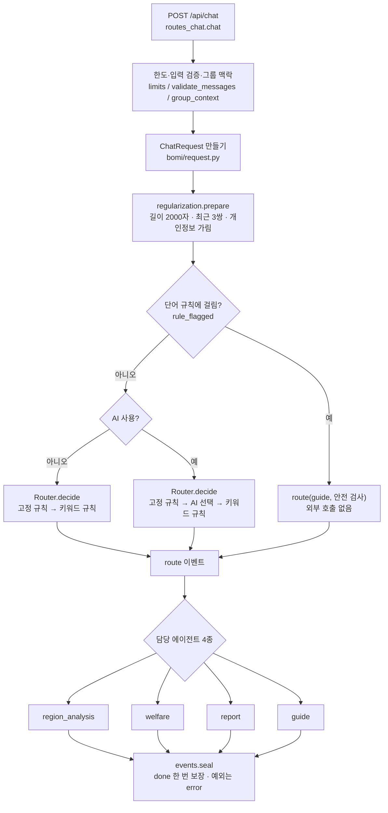

# 보미 챗봇 구조

보미의 요청 흐름, 모듈 책임, 규제 계층, 이벤트 계약, v16 근거 저장소 설계를 정리합니다.
실행·테스트·설정 방법은 [백엔드 안내](../backend/README.md#bomi), 재설계 과정과 측정 결과는 [보미 재설계 보고서](bomi-redesign-report.md)를 보세요.

## 1. 요청 흐름

진입점은 `POST /api/chat`(`backend/api/routes_chat.py`)이고, 답변은 `backend/bomi/pipeline.py`가 이벤트 스트림으로 만듭니다.



그림 원본은 [architecture/bomi_chat_flow.mmd](architecture/bomi_chat_flow.mmd)입니다.

## 2. 모듈 책임 (`backend/bomi/`)

| 파일 | 역할 | 하지 않는 일 |
|---|---|---|
| `api/routes_chat.py` | HTTP 요청 검사 → `ChatRequest` | 담당 선택, 답변 생성 |
| `pipeline.py` | 위 단계를 순서대로 연결 | 규칙·답변 로직 |
| `routing.py` | **담당 선택의 유일한 위치** | 자료 유무에 따른 대체 |
| `regularization.py` | 규칙·moderate API를 에이전트별 `Policy`로 적용 | 담당 선택 |
| `events.py` | 프런트와 맺은 이벤트 10종 계약, `seal` | |
| `request.py` | `ChatRequest`·`GroupSelection` 타입, 입력 검증 | |
| `questions.py` | 질문 분류 순수 함수, 키워드 목록 | |
| `phrases.py` | 고정 문구, AI 담당 선택 지시문 | 로직 |
| `aio.py` | 동기↔비동기 변환의 유일한 접점(`asyncio.run`은 여기서만) | |
| `agents/` | 담당별 답변 | `route`·`done` 이벤트 |
| `adapters/v16.py` | v16 엔진 연결(`sys.path` 조정을 이 파일 한 곳에 가둠) | |

`backend/chatbot/`에는 챗봇과 다른 기능이 함께 쓰는 부품만 남아 있습니다: AI 설정(`ai_settings.py`), 규칙 정의(`guardrails.py`), 분석 근거 AI 설명(`explain_ai.py`), 외부 AI 창구(`welfare/app/llm/`), 복지사업 자료 검색(`welfare/app/dialogue/resources.py`).

## 3. 담당 에이전트 4종

| 에이전트 | 역할 | 근거 |
|---|---|---|
| **region_analysis** | 동·그룹 분석 근거, 이상신호, 판정 기준, 지역 배경, 소비 | v16(PostgreSQL), 동·그룹 분석 결과 |
| **welfare** | 복지사업 조회, 신규 사업 구상 | 공유 DB2 복지자료, 스트리밍 |
| **report** | 약식보고서 초안 + «보고서 탭에서 수정» 버튼 | 업무 기록(`work`), 대화에서 찾은 사업 |
| **guide** | 업무 방법 질문·업무 무관 질문 | 고정 문구, 외부 AI 없음 |

모든 에이전트는 `RegulatedAgent`를 상속합니다. `respond()`가 입력 규제를 하고, 통과하면 `answer()`가 답합니다.

`region_analysis`는 안에서 설명기를 고릅니다. 자료가 없을 때의 대체는 라우터가 아니라 에이전트 안에 있습니다.

```
화면 판정 용어를 묻는 질문            → workspace (그룹이 열려 있으면 group, 아니면 district)
그룹이 열려 있고 그 그룹을 묻는 질문    → group
v16 자료(게시된 활성 run)가 없음        → workspace
그 밖                                → v16
```

AI 해석이 실패하면 외부 AI 없이 같은 근거로 다시 답하고, 그 앞에 `error` 이벤트를 보냅니다.
임베딩 기반 벡터 검색은 어느 에이전트에도 없습니다.

### 담당 선택 우선순위 (`routing.py`)

1. **고정 규칙**: 보고서 요청 → `report`, 업무 방법 질문 → `guide`, 화면 용어 질문 → `region_analysis`. AI 호출 없음.
2. **AI 선택**: AI 모드에서 `ROUTER_PROMPT`로 선택. 실패하거나 알 수 없는 값이면 3으로.
3. **키워드 규칙**: 복지 단어 → 열린 그룹 질문 → 분석 단어 → 사업 이름 → 동 이름 → `guide`.

## 4. 규제 계층 (`regularization.py`)

규칙의 정의(정규식·단어 목록)는 `chatbot/guardrails.py`에 있고, 이 계층이 에이전트별 `Policy`로 적용합니다.

| 단계 | 누가 | 무엇을 |
|---|---|---|
| 요청 직후 | 파이프라인 | 길이, 대화 길이, 개인정보 가림 (외부 AI로 보내기 전) |
| 입력 | 각 에이전트 | 단어 규칙 → moderate API(AI 모드만) → 걸리면 차단 안내 |
| 출력 | 각 에이전트 | 근거에 없는 연락처·URL·금액 가림, moderate API(AI가 쓴 글만) |

| 에이전트 | 입력 규칙 | 입력 moderate | 출력 가림(규칙) | 출력 moderate |
|---|:-:|:-:|:-:|:-:|
| region_analysis | ✓ | ✓ | `explain_ai`가 근거 대조 | ✓ (AI 해석문) |
| welfare | ✓ | ✓ | ✓ (전체 생성 후 사업별 근거 검사) | ✓ (원문 공개 전 검사) |
| report | ✓ | ✓ | `check_grounding`이 근거 대조 | ✓ (AI가 다듬은 경우) |
| guide | ✓ | ✓ | – | – (고정 문구) |

- moderate API는 OpenAI 키가 있을 때만 동작하고, 호출이 실패하면 통과시킵니다.
- 출력이 걸리면 이미 보낸 글도 `replace`로 통째로 바꿉니다.
- 단어 규칙에 걸린 질문은 외부 호출 없이 `guide`(by `안전 검사`)로 보내 차단합니다.

## 5. 이벤트 계약 (`events.py`)

화면(`frontend/src/BomiChat.jsx`)은 아래 10종을 처리하므로 이름과 내용 필드를 바꾸면 화면이 깨집니다.

| 이름 | 내용 | 화면에서 하는 일 |
|---|---|---|
| `route` | agent, label, by | 담당 이름 표시 |
| `sources` | records, mode | 참고한 복지사업 목록 |
| `conversation` | state | 다음 요청에 보낼 서명된 대화 근거 |
| `token` | text | 답변 글자를 이어 붙임 |
| `replace` | text, mode, source | 답변 전체를 교체 |
| `follow_ups` | questions | 후속 질문 버튼 |
| `actions` | actions | 액션 버튼 |
| `notice` | message, question(선택) | 안내문. question이 있으면 사용자 말풍선도 교체 |
| `error` | message | 오류 표시와 재시도 |
| `done` | (없음) | 스트림 완료. 없으면 화면이 «연결 중단» 오류를 냄 |

```
[notice(개인정보 가림)] → route →
  welfare           : [conversation] → sources → [notice] → token/replace → [notice] → [error → replace]
  그 밖의 에이전트   : [error] → replace → [follow_ups] → [notice] → [actions]
  차단(입력·출력)   : replace
→ done   (seal이 정확히 한 번)
```

`seal`은 예외를 상세 없이 `error`로 바꿉니다. 복지자료 DB 조회 실패(`WelfareDataError`)는 «복지자료 DB를 조회하지 못했습니다» 안내로 구분합니다.
화면은 `route`의 `agent` 값을 쓰지 않고 `label`만 표시합니다.

### 복지 검색과 대화 근거

`Router`가 담당을 선택하고 `agents/welfare.py`가 공통 `Policy`를 적용합니다. `chatbot/welfare/app/dialogue/retrieval.py`는 검색 조건, `semantic.py`는 의미 검색, `evidence.py`는 사업별 사실 검사를 담당합니다. DB 조회는 `db/welfare_chatbot_repository.py`, 색인·서명키 저장은 `db/welfare_search_store.py`에 둡니다.

`conversation.py`는 세션·지역·기준월·연령에 묶인 24시간짜리 사업 원문 스냅샷을 서명합니다. 파이프라인은 이 상태 이벤트를 연결한 뒤 `events.seal`로 마감하므로 저장 오류나 연결 취소에도 기존 예외 처리·종료 규칙을 따릅니다. 보고서 에이전트와 최종 미리보기는 서명된 대화 당시 근거를 사용합니다.

## 6. v16 근거 저장소

v16 엔진(`backend/agents/regional_v16/chatbot_agent`)의 데이터 접근을 하나의 계약 뒤로 모았습니다.

```
query_service · consumption_trends · orchestrator
        │  (SQL·연결을 직접 쓰지 않음)
        ▼
db1_repository.Db1Repository        ← 계약(Protocol): 어떤 조회를 제공하는지
        ▲
repository.SqlDb1Repository         ← 조회 로직(SQL·캐시·인덱스). SQL은 이 파일 안에만
        ▲
pg_repository.PostgresDb1Repository ← 유일한 구현: 고정한 run의 뷰를 읽음
```

- `Chatbot`은 저장소를 반드시 주입받습니다(없으면 `ValueError`). SQLite 서빙(`DataRepository`·`SqliteDb1Repository`, 단독 실행 `cli/main/menu`)은 없습니다.
- 챗봇 로직에 SQL·`sqlite3`가 다시 들어오지 않도록 `bomi/tests/test_db1_repository.py`의 `SqlStaysInsideRepositoryTest`가 소스를 검사합니다.
- 저장소 객체당 연결 1개를 재사용하고, 같은 표·코드 표는 요청 동안 한 번만 읽습니다(호출부에는 사본). `v16.reply()`는 요청이 끝나면 `repo.close()`를 부릅니다.
- 탐지 표(JSON 행)의 기간·동 조건은 SQL로 내리지 않습니다. 열 집합이 «읽은 행들의 키 합집합»이라 일부 행만 읽으면 열 구성이 달라질 수 있어, 동별 정렬 인덱스(이진 탐색)로 같은 목표를 달성합니다. 소비 원자료는 행 단위라 필요한 기간·동·연령만 SQL로 읽습니다.

### PostgreSQL 저장 구조

```
SQLite 공개본 ──publish──▶ db1.v16_<테이블>(run_id, 원래 열…)   run별 자료
                           db1.v16_run / db1.v16_active_run      이력 / 활성 run 포인터
                                       │
                           db1_v16.<테이블> (뷰)  ← 연결에 고정한 run의 행만, SQLite 테이블과 같은 이름·열
                                       │
                           PostgresDb1Repository ──▶ SqlDb1Repository의 조회 로직
```

| 설계 | 내용 |
|---|---|
| 게시 | `data_pipeline/publish_postgres.py`. 적재와 활성 포인터 변경이 **한 트랜잭션**이라 읽는 쪽은 이전 run 또는 새 run만 봄. 행 수가 원본과 다르면 전체가 되돌려짐 |
| 멱등 | 같은 공개본(내용 해시)을 다시 올리면 적재하지 않고 활성 run만 맞춤 |
| run 고정 | 저장소가 연결을 열 때 활성 run을 한 번 정해 세션에 고정. 한 답변 안에서 버전이 섞이지 않음 |
| 롤백 | `activate(engine, run_id)`로 이전 run을 다시 활성화. 갱신이 끝난(ready) run만 가능 |
| 정리 | 최근 `keep`개(기본 3, 활성 포함)만 남김. 요청 중인 저장소가 읽는 이전 run을 바로 지우지 않도록 2 이상 권장 |
| 열 변화 | 새 공개본에 열이 늘면 `ALTER TABLE ADD COLUMN`, 뷰를 다시 만듦 |
| JSON 열 | **TEXT로 저장**. JSON 형식은 `NaN`을 거부하고 키 순서를 바꿀 수 있어 원문 그대로 보존 |
| 세션 정리 | 연결을 닫을 때 `search_path`와 run 설정을 되돌려 풀의 다른 사용자에게 새지 않음 |
| 설정 | PostgreSQL만 씀. 남은 `DB1_REPOSITORY=sqlite`·오타 값은 오류(`data_ready()`는 경고 후 «자료 없음») |
| 장애 구분 | `data_ready()`가 «자료 없음»(활성 run 없음)과 «저장소 연결 실패»(오류 로그)를 구분 |

게시된 run이 없으면 `data_ready()`가 False라 v16 대신 동·그룹 분석이 답합니다(오류는 아님).
계산 파이프라인(`monthly_worker`·`runner`·`snapshot_manager`)은 계속 SQLite에 결과를 쓰고, 게시가 PostgreSQL로 옮깁니다.

### 조회 순서 규칙

여러 행을 돌려주는 조회는 `ORDER BY`를 명시합니다. 같은 SQL이라도 SQLite는 기본키 색인 순서로, PostgreSQL은 저장 순서로 돌려주기 때문입니다.
새 조회를 추가할 때 여러 행을 돌려준다면 기본키 순서의 `ORDER BY`를 함께 쓰세요.

### 파이프라인 산출물 게시 (`pipeline_state`·`ctx_weather`)

`pipelines/db1`이 내놓는 `db1.sqlite`에는 v16 월별 작업기가 만드는 두 테이블이 없습니다. **원본 파일을 고치지 않고** 게시 단계에서 메웁니다(`data_pipeline/db1_compat.py`).

| 대상 | 산출물 | 게시 때의 처리 |
|---|---|---|
| `pipeline_state` | 없음 | `v16_run`의 상태에서 같은 이름·열의 **뷰**를 만듦. 산출물에는 «갱신 완료» 표지가 없어 준비 상태는 확인하지 못함 |
| `ctx_weather` | `ctx_weather_month` + `ctx_weather_window` | 작업기의 `weather_context`와 **같은 모양**(`label_weather`, `observation_month_weather`)으로 변환해 적재. 원천이 없으면 빈 표 |

산출물에는 «눈 기록이 `-`(확인 불가)였는지» 정보가 없어 변환 결과의 `snow_status`는 모두 `observed`입니다.
